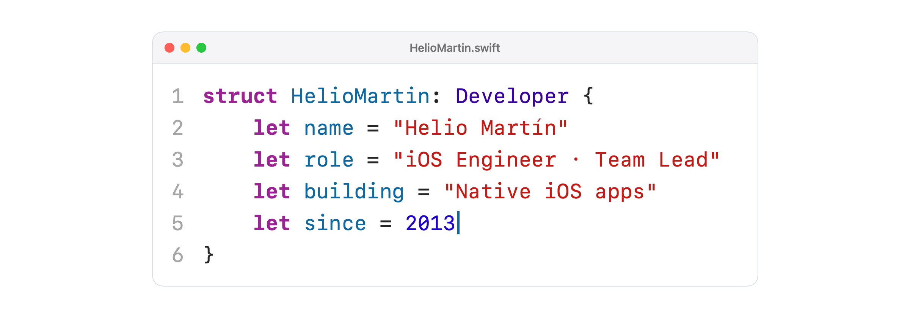

<picture>
  <source media="(prefers-color-scheme: dark)" srcset="assets/banner-dark.png">
  
</picture>

### Hi, I'm Helio 👋

I'm an iOS engineer based in Spain. I've been building native apps for iPhone
and iPad since 2013, and leading iOS teams since 2015.

- 📱 **13 years of iOS**, from Objective-C and UIKit to Swift and SwiftUI.
- 🧭 **Team lead since 2015** for iOS and mobile teams.
- 🛠 **Currently building KeylineKit**: measured layout annotations for SwiftUI previews. Coming soon.
- 🌍 I work in **Spanish** and **English**.

## 🧰 Tech

  
  
  
  
  

## 📦 Open source

| Project | What it does | |
| --- | --- | --- |
| [HMStackView](https://github.com/HelioMartin/HMStackView) | A swipeable card stack for iOS that holds view controllers instead of views. | ⭐ 28 · Objective-C |
| [RXPiOSObjc](https://github.com/HelioMartin/RXPiOSObjc) | Objective-C helpers to add the Addon Payments HPP checkout to iOS apps. | Objective-C |
| [Contacts-Framework](https://github.com/HelioMartin/Contacts-Framework) | A 2015 Contacts.framework patch that exposes CNContact's private `iOSLegacyIdentifier`. | Objective-C |

## 🤝 Connect

